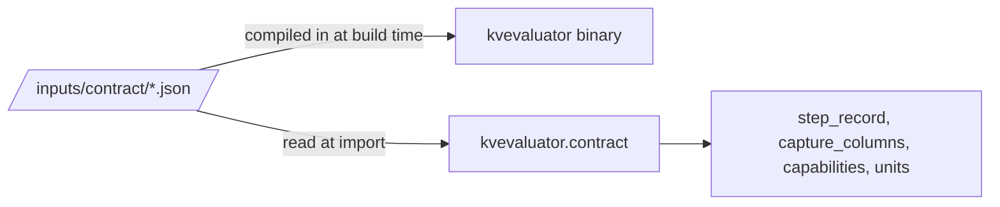

# The facts C++ and Python share (`inputs/contract/`)

The C++ evaluator and the Python side must agree on a few facts: which KV ops a plan step may name, which capability
names a plan may require, and which columns a capture file has. Each fact is written once, in a data file in
`inputs/contract/`. Both sides read the same file, so there is no copy to keep equal. This page sits beside the C++
reader (`contract.h`).

| file | what it holds | C++ reads it in | Python reads it in |
|---|---|---|---|
| `kv_ops.json` | every KV op: its kind, whether every format serves it, its arguments with their defaults, what it refuses; for a read, the stored part it reads, the argument naming its unit, the capabilities a body using it needs | `ops/kv_contract.cc` (`kvevaluator ops` prints it) | `plans/ir/capabilities.py` (`KV_OPS`, `OP_REQUIRES`), `capture/step_record.py` (`PART`), `plans/units.py` |
| `capabilities.json` | the capability vocabulary, each capability's class (validity or selector) and what it implies, and the coarse-chunk threshold | `ir/plan.cc` (the vocabulary), `formats/format.h` (the threshold) | `plans/ir/capabilities.py` |
| `capture_columns.json` | the columns of a capture's files (counts, steps, parts, and their write forms) and of the step record, as named groups | `cli/capture_writer.cc` (`kvevaluator predict --capture-columns` prints them) | `capture/step_record.py`, `capture/capture_columns.py` |

**C++ compiles the files in** (`cpp/kvevaluator/cmake/embed_contract.cmake`, read by `contract.h` here), so a
binary carries the facts of the commit it was built from: its commit and dirty flag describe what it does. The build
cache (`run/build_cpp.py`) keys on `inputs/contract/`, so an edit there makes a new build, and a gate refuses a binary
built before it (`capture/binary.py`, the stale-binary rule). Both set `.md` files aside, so editing this page makes no
new build. Python reads the files through `kvevaluator.contract`.

## The fields

`kv_ops.json`, one entry per op:
- `kind`: `read` or `write`. `every_format`: false for an op only some formats serve (`index_range_buckets`).
- `args`: each argument's `name`, whether a plan must give it (`required`), and its `default` when it may be left out
  (absent: the op reads it as absent). `refusals`: what a step is refused for, in words.
- A read also has `part` (`adjacency`, `vertex_props` or `index`: the stored part it reads), `unit` (the argument that
  names the edge type or vertex label its cost is charged to; a write has none) and `requires` (the validity
  capabilities a body that runs this op needs; `property_index` is stamped by the plan dumper at emit).

`capabilities.json`: `chunk_coarse` (bytes), `last_chunk_fill` (a Chunked family's last chunk's assumed share of its pack
target: the half chunk view and a sampled tally's last chunk), and per capability its `class`, `implies` (a selector whose bodies still
need a validity capability), `store_derived` (derived from the store, never declared by a format), `stamped_at_emit`,
and `doc` / `evidence` (what it means; why it has its class).

`capture_columns.json`: `groups` (each a list of columns), `response_keys` (a group whose columns read a named field of
the response), `sequences` and `files` (each a list of group names, expanded in order). A `byte_lanes_*` group takes a
`_bytes` suffix where a file names its byte lanes that way.

## Why each format's capability rules are not here

The vocabulary is data. Which capabilities a format grants is not: it is a rule over the schema and the layout spec.
Dgraph grants `type_index` only when every label declares the type index, and `sorted_range_index` on a label only when
every date index the label declares is key-sorted (`cpp/kvevaluator/src/formats/dgraph/format.cc`, `capabilities` and
`capabilities_for`). Meta decides per label from its spec: `whole_row_read` where the label's props are grouped,
`label_scan_carries_props` where they are packed, `adjacency_lists` per edge type where every stored direction is a list
(`formats/meta/format.cc`). Written as data, these rules would need a small rule language, and its conditions would
still be code on both sides. So the rules stay code, in each format on both sides, and
`tests/unit/check_caps_parity.py` holds them equal for every format, design, label and edge type.

## Changing a fact

1. Edit the file here.
2. Rebuild the binary (`just build`) and run `python tests/unit/check_contract_files.py`: it checks the files' shape and
   that no Python op list names an op the table lacks.
3. A new byte lane or op count also needs its counter in C++ (`store/counting.h`, `Counts::to_json`); the ctest case
   `contract_data_matches_code` fails until the two agree.

Python code slices `capture/step_record.py`'s lane lists; a retyped list of byte lanes fails `just lint` (the
`lane-list` count in `tests/lint/check_layers.py`).
