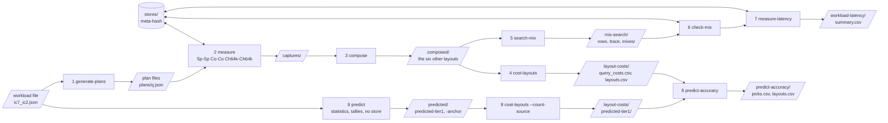

# From a workload to its best layout: a detailed, hands-on walkthrough

Run the pipeline step by step on a workload small enough to see everything, then on your own queries. Every number
below is from the files the commands write, in one run on an empty output dir (every store built new), LDBC SF0.1.

**The workload.** Two LDBC Interactive queries, IC7 and IC2, each run once
(`inputs/workloads/ldbc/examples/ic7_ic2.json`), each with three candidate plans:

| query | what it asks | candidate plans (bodies) |
|---|---|---|
| IC7 | recent likers: the latest likes on a person's messages, and whether each liker is a friend | `edge_probe`, `edge_probe_out`, `materialize_intersect` |
| IC2 | recent messages by a person's friends | `index_walk`, `one_phase`, `two_phase` |

The two are chosen as a pair: IC7's cheapest plan changes with the layout, IC2's does not.

**The question.** Each part of the schema (each vertex type's properties, each edge type's adjacency lists) can be
stored Split, Condensed or Chunked. Which setting per part makes this workload cheapest?

**The answer, in short.** Every part Condensed except the likes lists, which are Chunked: 312.245 wops_bytes4k per run
of both queries, proven optimal (step 5). The best uniform layout, Co-Ch64k (properties Condensed, every list Chunked),
costs 396.59: the mix is 21% cheaper. IC7 needs the likes lists packed; packing the other lists too saves 3 wops
(105.0 against 108.1) and reads 0.36 MB more per run, which costs more than it saves. With a byte limit, the search
has to work harder: step 5's second example starts from 1,508 wops and ends at 105.

**Without a store**, step 8 predicts the same costs from statistics of the graph: with the population's statistics it
names Co-Co (measured 1527.23); with the persons the parameters bind, it names Co-Ch64k, as measured. The mix search on
either level's counts finds step 5's mix.

**Your own queries** take the same commands: section "Your own queries" walks through two, from the Python function to
the checked mix; section "Write a layout yourself" shows a spec.

## The flow



Each command takes the workload file (`--workload`) and the dataset and scale (`--dataset ldbc=0.1`), and writes into
the output dir's places (`python/kvcost/cli/README.md`, "Where each command writes"): the stores in `stores/`, the
counts in `captures/` and `composed/`, the statistics in `stats/`, the predicted counts in `predicted/`, the timings in
`timings/`, and each workload's answers in `summary/ldbc/sf0.1/`. A store and a capture are shared by every workload
that needs them. Each step answers the same seven questions, in this order:

1. **What it does**, in one sentence.
2. **In:** which files.
3. **Out:** which files, where.
4. **The command.**
5. **What you open to see it**, with the real SF0.1 output pasted (a few rows).
6. **The check that guards it.**
7. **The code.**

Run every command from the artifact's root, after step 0, in a shell with:

```bash
source .venv/bin/activate             # puts kvcost on the PATH
W=inputs/workloads/ldbc/examples/ic7_ic2.json
OUT=${KVEVAL_OUTPUT_DIR:-output}      # the output dir
```

Every command prints the workload and the output dir in full on its first line, and the paths after it relative to
the output dir; its last line, starting with `==>`, is its answer: the plans generated, the queries measured, whether
`composed/` changed, the fewest layout, the search's verdict, PASS or FAIL. Wall times are from one run on an Intel
Xeon Gold 5512U (28 cores). Costs are per run of a query, the mean over its five reported params, in **wops_bytes4k**,
the op-byte cost (wops + bytes / 4096, where wops = G + 1.1 S + 0.01 N; `python/README.md`, "Cost models") unless a
step names wops alone; floats are rounded here, the files keep them whole.

## Step 0: build and fetch

### 0.1 What it does

Installs the two Python packages (`kvevaluator`, `kvcost`) and the `kvcost` command into the repo's venv, builds the
C++ evaluator (the one binary that ingests stores and runs plans), and fetches the dataset.

### 0.2 In

The artifact's source; `uv` and a C++ toolchain on the machine (README, "Getting started"; RocksDB is fetched and
built at a pinned commit the first time); LDBC SNB Interactive SF0.1 (a 25 MB download).

### 0.3 Out

- `.venv/` with both packages, and `build/cpp/kvevaluator`, the binary. `--version` prints the commit it was built from
  and whether the tree was dirty; every later step prints it first.
- `data/datasets/ldbc/sf0.1/` (the CSVs, the update streams) and the params, each file checked by sha256.

### 0.4 The command

```bash
just setup                    # ~1 min
just build                    # ~4 min
just smoke                    # 10 s
just fetch-dataset ldbc=0.1   # ~5 s
```

### 0.5 What you open

`just smoke` ends with `smoke OK: <n> modules, kvevaluator 0.1.0 (binary <commit>, dirty false)`, the fetch with
`fetch-dataset OK (fetch): ldbc=0.1`.

### 0.6 The check

`just smoke`: every module imports, the binary builds and runs. The fetch refuses a file whose sha256 differs. A result
counts only from a clean binary.

### 0.7 The code

`justfile` (`setup`, `build`, `smoke`, `fetch-dataset`); `python/kvevaluator/fetch_dataset.py` `main`.

## Step 1: the workload and its plans

### 1.1 What it does

Reads the workload file, writes each query's plan file from its Python function (the plan IR, the contract the C++ side
reads), and prints each query's question, params and candidate plans, one per line, with the choice points marked.

### 1.2 In

- The workload file:

  ```json
  {
   "id": "ic7_ic2",
   "name": "ic7_ic2",
   "title": "IC7 and IC2, each once: the layout-cost walkthrough's workload",
   "items": [
    {"family": "interactive", "query": "ic7", "frequency": 1, "params": null},
    {"family": "interactive", "query": "ic2", "frequency": 1, "params": null}
   ]
  }
  ```

  `family` is the query set the query belongs to (LDBC Interactive here), `frequency` how often it runs,
  `params: null` the mean over the query's params.
- The queries: `python/kvevaluator/workloads/interactive/queries/ic7.py` and `ic2.py`; their questions:
  `workloads/interactive/questions.json`.

### 1.3 Out

`python/kvevaluator/workloads/interactive/plans/ic7.json` and `ic2.json`, committed: writing them again changes
nothing.

### 1.4 The command

```bash
kvcost generate-plans --workload $W --dataset ldbc=0.1      # ~1 s
```

### 1.5 What you open

The printout, IC7's part (IC2's is printed the same way):

```
ic7 (interactive): Given a person, find the 20 most recent likes of their messages, with each liker, the liked message, the like delay and whether the liker is a friend.
  params: person: id
  choice point: flagged (membership_flag); the plan rule picks one body per layout (wops_bytes4k on the held-out params), inside cost-layouts and search-mix
  bodies (3):
    edge_probe             19 steps; its own steps: flagged = read_edge_exists(reads=[{"dir":"out","at":"anchor"},{"dir":"in","at":"anchor"}])
    edge_probe_out         19 steps; its own steps: flagged = read_edge_exists(reads=[{"dir":"out","at":"anchor"},{"dir":"out","at":"cand","unless_found":...)
    materialize_intersect  21 steps; its own steps: friends0 = read_neighbors, friends = dedup, flagged = flag_in
  file: python/kvevaluator/workloads/interactive/plans/ic7.json
...
==> [kvcost generate-plans] 2 queries, 6 bodies, 2 with a choice point; 0 plan files written (--steps prints every body's steps)
```

Each body is one line: its name, its step count, and the steps only it has (with the arguments that differ where
another body has a step of the same name). The three IC7 bodies differ at one choice point, `flagged`, the step that
answers "is this liker a friend": `edge_probe` probes one `knows` edge per liker, in each direction; `edge_probe_out`
probes the out direction first; `materialize_intersect` reads the person's whole friend list once and checks each liker
against it. `--steps` prints every step of every body. "0 plan files written": the files are what the functions make.

### 1.6 The check

`uv run python tests/unit/check_plan_files.py` (~50 s): every plan file equals what its function serializes now, and
each format's plan choice is reproduced from the files (`PLAN FILES OK`).

### 1.7 The code

`python/kvcost/cli/verbs.py` `cmd_generate_plans`; `python/kvevaluator/plan_choice/generate.py` (the candidate bodies);
`python/kvevaluator/workloads/__init__.py` `query` (a query's question, params and plan file).

## Step 2: measure

### 2.1 What it does

Builds the store of each layout named (when missing) and runs every candidate plan of the family's queries on it,
counting each KV operation and byte per run, per plan step, and per part of the schema the step touched.

### 2.2 In

- The layouts, by short name: properties-adjacency, Sp Split, Co Condensed, Ch64k Chunked at 64 KB. Sp-Sp, Co-Co and
  Ch64k-Ch64k, one setting on both sides; the other six of the 3 x 3 grid are composed from them (step 3). Each name
  is one spec (`inputs/specs/grid/`, `python/kvevaluator/layouts.py`).
- The plan files of step 1, the dataset and its params: params 1-5 are the reported ones, 11-15 the held-out ones that
  choose the plan (`python/README.md`, "Pick").

### 2.3 Out

- The stores, `$OUT/stores/ldbc/sf0.1/meta-<12 hex digits>/`, each named by the hash of its expanded spec: Sp-Sp
  `meta-5019375411fb` (49 MB), Co-Co `meta-71de16feb8c5` (35 MB), Ch64k-Ch64k `meta-69bcf6a70e27` (31 MB). Two files
  that hold one layout share one store.
- The record stream, `$OUT/stats/ldbc/sf0.1/records.jsonl`, dumped once per scale: the stores are ingested from it,
  and step 8's statistics are made from it.
- The captures, kept for every later workload: `$OUT/captures/ldbc/sf0.1/interactive/{reported,held-out}/
  {counts,steps,parts,row-hashes}/<cell id>.csv`, beside `counts/<cell id>.json` (what produced it: the binary, the
  spec, the store, the inputs). A cell id names the layout (`props_split_adj_split` is Sp-Sp).
  - `counts`: one row per run (layout, query, param, plan): its S / G / N, misses, the bytes read per lane, its rows and
    answer hash.
  - `steps`: one row per plan step of each run: its operator, rows in and out, the same counts.
  - `parts`: a step's counts split by the part of the schema it read (`adj:Person:knows:out`, `props:Comment`). These
    rows are what lets a mix be priced without building it (steps 3 and 4).

A capture holds the whole family (LDBC Interactive's 19 queries), not only IC7 and IC2, so another workload of the
family reuses it.

### 2.4 The command

```bash
kvcost measure --workload $W --dataset ldbc=0.1 Sp-Sp Co-Co Ch64k-Ch64k      # ~40 s, the three stores' ingest included
```

### 2.5 What you open

The command's output, rows cut:

```
[kvcost measure] binary build/cpp/kvevaluator at 649076b8f2 dirty=false
[reads interactive Ch64k-Ch64k] [stores] ingesting ldbc 0.1/meta-69bcf6a70e27 (props_chunked_adj_chunked) (first use)
...
[kvcost measure] reads interactive: Ch64k-Ch64k done · Co-Co done · Sp-Sp done
[check interactive] answers: 95/95 (query, param) identical across all 3 cells
[check interactive] RESULT: PASS (a slice: 3 of 9 cells, full coverage on them; same answers everywhere; every step's cost follows its own component)
[kvcost measure] reads interactive Sp-Sp: 0 of 1 reused, 1 measured
...
==> [kvcost measure] DONE (interactive on ldbc at 0.1, 7 calls, 39s): captures in <output>/captures/ldbc/sf0.1
```

`counts/props_split_adj_split.csv` has 265 rows, 30 of them IC7 and IC2 (2 queries, 3 plans each, 5 params). Param 1
on the three layouts (columns cut):

| layout | query | body | measure_only | S | G | N | read_bytes | rows |
|---|---|---|---|---|---|---|---|---|
| Sp-Sp | ic7 | `edge_probe` | 0 | 770 | 93 | 880 | 35,157 | 20 |
| Sp-Sp | ic7 | `edge_probe_out` | 0 | 770 | 90 | 880 | 35,100 | 20 |
| Sp-Sp | ic7 | `materialize_intersect` | 0 | 772 | 53 | 1,220 | 43,910 | 20 |
| Co-Co | ic7 | `edge_probe` | 0 | 772 | 25 | 0 | 18,346 | 20 |
| Co-Co | ic7 | `edge_probe_out` | 1 | 788 | 25 | 0 | 24,574 | 20 |
| Co-Co | ic7 | `materialize_intersect` | 0 | 772 | 25 | 0 | 18,346 | 20 |
| Ch64k-Ch64k | ic7 | `edge_probe` | 0 | 24 | 0 | 0 | 1,200,826 | 20 |
| Sp-Sp | ic2 | `index_walk` | 0 | 12 | 32 | 5,483 | 112,660 | 20 |
| Sp-Sp | ic2 | `one_phase` | 0 | 10 | 8,644 | 3,819 | 347,838 | 20 |
| Co-Co | ic2 | `index_walk` | 0 | 12 | 25 | 1,664 | 44,180 | 20 |
| Ch64k-Ch64k | ic2 | `one_phase` | 0 | 271 | 0 | 0 | 15,010,612 | 20 |

On Sp-Sp (Split lists) IC7's three plans do different work for the same 20 rows. On Co-Co (Condensed lists)
`edge_probe` and `materialize_intersect` do the same work, and `edge_probe_out` is measured but marked measure-only: it
is never picked there. IC2's plans differ everywhere, by large margins. Every plan returns the same 20 rows.

### 2.6 The check

Every plan of a query must give the same answer (rows and result hash); a capture whose plans disagree is refused
(`grid_bodies`). Across layouts the answers are compared by the grid check the command runs last
(`tests/gates/check_grid.py`: `answers: 95/95 ... identical` above). A capture is reused only while its store, plans,
params and counting versions are unchanged (`--fresh` measures again).

### 2.7 The code

`python/kvcost/cli/verbs.py` `cmd_measure`; `python/kvevaluator/measure/run_measure.py` `calls`, `run_calls` (one
call per store, reused when fresh); `python/kvevaluator/measure/stores.py` `cpp_store_name` (the store's hash name),
`store_path`; `python/kvevaluator/measure/grid_bodies.py` `measure_cell` (the runs through the C++ driver).

## Step 3: compose the other layouts

### 3.1 What it does

Writes the six layouts that mix two settings (Sp-Co, Co-Ch64k, ...) from the three measured ones, part by part,
without a store: a layout's property and index parts come from the measured layout with its properties setting, its
list parts from the one with its lists setting.

### 3.2 In

The captures of step 2.

### 3.3 Out

`$OUT/composed/ldbc/sf0.1/interactive/{reported,held-out}/`: the six layouts, in the shape of `captures/`. Every later
step reads a layout from `captures/` when it was measured itself, else from `composed/`. Each composed layout's run
record names the measured files it was made from (one measured again since marks it stale).
`exact/<cell id>.csv` holds, per query and body, whether its composed cost is exact (`yes`: equal to what that layout's
own store would count) and, if not, why (`unknown`: a body did not run cleanly on both source layouts, so the pick is
made over fewer bodies and the price may move either way; the `why` column names the rows).

### 3.4 The command

```bash
kvcost compose --dataset ldbc=0.1      # ~1 s
```

### 3.5 What you open

The output:

```
  6 composed from their parts (Sp-Co, Sp-Ch64k, Co-Sp, Co-Ch64k, Ch64k-Sp, Ch64k-Co)
  exact: every query's composed cost equals what that layout would measure (exact/<layout>.csv: per query, yes or why not)
==> [kvcost compose] <output>/composed/ldbc/sf0.1 written: the layouts not measured, composed from the measured diagonals (0.3 s; each layout's wall_s in its run record)
```

A query that is not exact on some layout is listed instead, one line per layout and param set.

Run again, it composes again (seconds) and compares, file by file: a byte-identical file is kept (`composed/ldbc/sf0.1
unchanged`), a new one added, a changed one (a measured capture or our code changed) moved aside, never deleted. It is
composed again every time, rather than reused by a key, because its value also depends on our own code. `-v` prints
the composer's every line (each layout, each param set's exact count).

### 3.6 The check

A composed layout that was also measured must equal it row for row (counts, steps, parts): measure Sp-Co too
(`kvcost measure --workload $W --dataset ldbc=0.1 Sp-Co`, ~25 s) and `compose` compares the composed Sp-Co with it
(`0 problems, 0 rows differ from measured files`), then reads the measured one. `cost-layouts` (step 4) also compares
each measured layout with its composition.

### 3.7 The code

`python/kvcost/cli/verbs.py` `cmd_compose`; `python/kvcost/layout_cost/compose_cells.py` `compose`, `compose_reads`,
`check`.

## Step 4: cost the layouts

### 4.1 What it does

Prices each query on each layout at the plan the plan rule picks there (the cheapest on the held-out params), in every
cost model, and gives the workload's total per layout.

### 4.2 In

The captures and the composed dir (steps 2 and 3), the workload, and the model the totals are printed in
(`--cost-model`; the files hold every model).

### 4.3 Out

`$OUT/summary/ldbc/sf0.1/layout-costs/ic7_ic2/measured/`:

- `query_costs.csv`: one row per (query, layout, chunk view): the picked plan, its wops, bytes and wops_bytes4k, and
  every raw channel (S, G, N, the byte lanes). The two chunk views (`half`, `measured`) differ only for writes.
- `query_parts.csv`: the same plan's cost per part kind (adj, props, index).
- `layouts.csv`: per layout, the totals at the workload's frequencies.
- `README.md` (what each file holds) and `runs.jsonl` (each call, with its wall time).

### 4.4 The command

```bash
kvcost cost-layouts --workload $W --dataset ldbc=0.1 --cost-model wops_bytes4k      # ~2 s
```

### 4.5 What you open

The output ends with the totals, the workload once at its frequencies, and each over Sp-Co's:

```
[kvcost cost-layouts] measured view: 9 layouts, 3 measured compared with their composition, 0 differ outside miss-key bytes: PASS
[kvcost cost-layouts] wops_bytes4k per layout (sum over the queries), 9 layouts in the place, and over Sp-Co (Dgraph's layout):
  Co-Ch64k           396.59   0.253x  fewest
  Sp-Ch64k          437.938   0.279x
  Ch64k-Ch64k       649.466   0.414x
  Co-Co             1527.23   0.974x
  ...
==> [kvcost cost-layouts] the fewest wops_bytes4k: Co-Ch64k, 396.59 (0.253x Sp-Co's 1568.58); rows in summary/ldbc/sf0.1/layout-costs/ic7_ic2/measured/ (9 layouts)
```

`query_costs.csv`, per run (the `measured` view):

| layout | IC7 plan | IC7 wops | IC7 bytes | IC2 plan | IC2 wops | IC2 bytes | both, wops_bytes4k |
|---|---|---|---|---|---|---|---|
| Sp-Sp | `materialize_intersect` | 1507.752 | 85,564 | `index_walk` | 106.604 | 114,997 | 1663.32 |
| Co-Sp | `materialize_intersect` | 1477.152 | 88,321 | `index_walk` | 94.804 | 116,548 | 1621.97 |
| Ch64k-Sp | `materialize_intersect` | 1461.772 | 673,253 | `index_walk` | 80.604 | 688,556 | 1874.85 |
| Sp-Co | `edge_probe` | 1482.800 | 30,143 | `index_walk` | 67.774 | 43,593 | 1568.58 |
| Co-Co | `edge_probe` | 1452.200 | 32,899 | `index_walk` | 55.974 | 45,144 | 1527.23 |
| Ch64k-Co | `edge_probe` | 1436.820 | 617,832 | `index_walk` | 41.774 | 617,152 | 1780.10 |
| Sp-Ch64k | `edge_probe` | 82.720 | 918,001 | `index_walk` | 64.694 | 271,986 | 437.94 |
| Co-Ch64k | `edge_probe` | 52.120 | 920,757 | `index_walk` | 52.894 | 273,538 | 396.59 |
| Ch64k-Ch64k | `edge_probe` | 36.740 | 1,505,690 | `index_walk` | 38.694 | 845,545 | 649.47 |

IC7's plan follows the lists setting (`materialize_intersect` on Split lists, `edge_probe` on the others); IC2's is
`index_walk` on all nine. Chunked lists cut IC7's wops 18 to 28 times (one SEEK per chunk, not one per message's likes
list) and read 28 to 30 times its bytes.

IC7 reads five parts (hasCreator lists, knows lists, likes lists, Message props, Person props), three settings each:
its cost under every combination is a table of 3^5 = 243 entries; IC2 reads four, 81 entries. The search (step 5)
reads these tables; a mix of your own is priced from them too:

**A mix of your own, priced from the parts.** `--mix` prices a mix without building it: an assignment string (named by
`--mix-name`, `--mix-base` setting every part it leaves out). Its rows go into the same files as the uniform layouts',
`kind` mix:

```bash
kvcost cost-layouts --workload $W --dataset ldbc=0.1 --cost-model wops_bytes4k \
  --mix "knows lists=Ch64k" --mix-base Co-Sp --mix-name knows-chunked      # ~2 s
kvcost list-parts --workload $W --dataset ldbc=0.1                         # the parts a mix can name
```

`knows-chunked` costs 1671.79: it packs the knows lists, which IC7 reads little, and leaves the likes lists Split.
`list-parts` prints every part the captures hold: 6 props parts (`Message props`, `Person props`, ...) and 15 lists
parts (`hasCreator lists`, `knows lists`, `likes lists`, ...).

Several parts go in ONE string, joined by `;`:

```bash
kvcost cost-layouts --workload $W --dataset ldbc=0.1 --cost-model wops_bytes4k \
  --mix "knows lists=Ch64k; Person props=Ch64k" --mix-base Co-Co --mix-name all-chunked
```

Two `--mix` strings with one `--mix-name` are refused before any pricing (one `--mix-name` names one string). A spec
file is given as a layout, named by its file's stem; any spec file works, the full or the short form, for example
step 5's (after step 5):

```bash
kvcost cost-layouts --workload $W --dataset ldbc=0.1 --cost-model wops_bytes4k \
  $OUT/summary/ldbc/sf0.1/mix-search/ic7_ic2/mixes/mixes-of-Sp-Co-Ch64k-wops_bytes4k.json
```

prices it at 312.245, the search's own total.

**Figures.** `kvcost plot-costs --workload $W --dataset ldbc=0.1` draws, per query, each layout's cost over Sp-Co
(Dgraph's layout), one panel per model on a log scale, and the totals:
`summary/ldbc/sf0.1/layout-costs/ic7_ic2/measured/plots/per_query_interactive.png` and `totals.png`.

### 4.6 The check

Each measured layout is compared with its composition (`3 measured compared with their composition, 0 differ`
above). The plan and its cost come from the same function the search uses (`compose.query_pick`).
`tests/unit/check_mix_search_export.py` checks the search's cost tables on a toy example;
`tests/gates/check_kvcost_mix_from_diagonal.py` checks that a mix priced from the three measured layouts equals the same
mix priced from all nine measured, and so do the nine uniform layouts' rows.

### 4.7 The code

`python/kvcost/cli/search.py` `cmd_cost_layouts`, `mix_assignment`, `cmd_list_parts`, `cmd_plot_costs`;
`python/kvcost/layout_cost/uniform_49.py` `cost_layouts`; `python/kvcost/layout_cost/layout_costs.py` (the files, their
writer and readers); `python/kvcost/layout_cost/compose.py` `query_pick` (the plan the rule picks, and its cost vector).

## Step 5: search

### 5.1 What it does

Finds the mix (one setting per part) with the fewest wops_bytes4k summed over the workload, within a byte limit if one
is given, and proves it the minimum, by branch and bound.

### 5.2 In

The captures and the composed dir, the workload's frequencies, the model, and optionally `--byte-limit` (a multiple of
Sp-Co's bytes, `2x`, or a size, `68MB`).

### 5.3 Out

In `$OUT/summary/ldbc/sf0.1/mix-search/ic7_ic2/`:

- `mixes-of-Sp-Co-Ch64k.json`, the result rows (the mix, its totals, proven or not, the nodes searched, what it read),
  and `mixes-of-Sp-Co-Ch64k.csv`, one row per search, the mix one column per part.
- `mixes-of-Sp-Co-Ch64k-wops_bytes4k-trace.csv` (`--trace`): one row per decision the search made.
- `mixes/mixes-of-Sp-Co-Ch64k-wops_bytes4k.json`: the mix as a spec, the input of step 6; and `mixes/best.json`, the
  last search's.

A search under a byte limit has its own trace and spec, named by the model and the limit:
`mixes-of-Sp-Co-Ch64k-wops-15x-trace.csv`, `mixes/mixes-of-Sp-Co-Ch64k-wops-15x.json`; its row is added beside the
first. So searches with and without a limit never replace each other's files. With `--trace` or a byte limit, the
search builds the **mix cost cache**, each query's table of step 4, in `$OUT/stats/ldbc/sf0.1/mix-cost-cache/` (one
`.npz` per query, reused by every later call at this scale).

### 5.4 The command

```bash
kvcost search-mix --workload $W --dataset ldbc=0.1 --cost-model wops_bytes4k --trace      # ~2 s
```

### 5.5 What you open

The output, its last lines:

```
[kvcost search-mix] trace: 17 decisions in summary/ldbc/sf0.1/mix-search/ic7_ic2/mixes-of-Sp-Co-Ch64k-wops_bytes4k-trace.csv (the row's 6 nodes)
[kvcost search-mix] 6 nodes; started from the two-step mix (from condensed/chunked)
...
==> [kvcost search-mix] PROVEN: the fewest wops_bytes4k: 312.245 wops_bytes4k, 108.094 wops, 836204 bytes; the mix in summary/ldbc/sf0.1/mix-search/ic7_ic2/mixes/mixes-of-Sp-Co-Ch64k-wops_bytes4k.json
```

The mix (`mixes-of-Sp-Co-Ch64k.csv`): hasCreator lists, knows lists, Message props and Person props Condensed; likes
lists Chunked. 312.245 against the best uniform layout's 396.59 (Co-Ch64k).

The trace has one row per decision, in the order the search made them. Its columns:

| column | what it holds |
|---|---|
| `step` | the decision's number |
| `verdict` | what the search did (below) |
| `node` | the search node that decided: node 0 is the root, before any part is set |
| `child` | for `explored`: the node it enters |
| `part`, `option` | the part being set, and the setting tried |
| `mix_so_far` | the parts already set on the way to this node |
| `floor_wops_bytes4k`, `floor_bytes` | the least any mix below this node can cost (each part not yet set at its cheapest for each query), summed over the workload |
| `best_wops_bytes4k`, `best_bytes` | the best full mix found so far |

(With `--cost-model wops` the columns are `floor_wops`, `floor_bytes`, ...; with `--cost-model bytes`, `floor_bytes`,
`floor_wops`.) Here, columns cut, floor and best in wops_bytes4k:

| step | verdict | node | child | part | option | floor | best |
|---|---|---|---|---|---|---|---|
| 0 | start | 0 | | | | 312.245 | 312.245 |
| 1-7 | dominated | 0 | | hasCreator: split, chunked; knows: split, chunked; Message props: chunked; Person props: chunked; likes: split | | | |
| 8-12 | explored | 1-5 | 2-6 | hasCreator, knows, Message props, Person props, likes lists | condensed, condensed, condensed, condensed, chunked | 312.245 | 312.245 |
| 13 | leaf: not better | 6 | | | | 312.245 | |
| 14-16 | cut: floor not below the best | 5, 4, 3 | | likes condensed; Person props split; Message props split | | 1527.228, 336.661, 329.178 | |

How to read it:

- **start**: the first mix to beat, the two-step mix. From the best uniform layout (Co-Ch64k), (a) each part alone
  takes its cheapest setting, the others fixed, and these choices combine; (b) then one part at a time changes while
  that lowers the total. It is a greedy mix, not proven: the search below proves or beats it. Here it is already the
  answer. Under a byte limit where the two-step mix does not fit, the start is the best uniform layout that does.
- **dominated**: a setting that another setting of the same part beats or ties on every query, in both wops_bytes4k
  and bytes, whatever the other parts are; it is left out before the search (seven here).
- **explored**: the search sets one part and enters the child node.
- **leaf: new best / leaf: not better**: every part set; the full mix's total, against the best so far.
- **cut: floor not below the best**: no mix below this node can beat the best; the search skips it.
- **cut: over the byte limit**: every mix below this node reads more bytes than the limit.
- **cut: lagrange bound**: under a byte limit, a second lower bound (the cheapest mix at a price per byte) already
  above the best.

The search is **PROVEN** when it ends with every branch explored or cut: no mix left could be cheaper than the best.
`NOT PROVEN (node limit)` means `--max-nodes` stopped it first; the answer is then the best found.

**When the search has to work: a byte limit.** The same workload under wops alone, with the bytes held to 15 x Sp-Co's
(1.1 MB per run of both queries):

```
kvcost search-mix --workload $W --dataset ldbc=0.1 --cost-model wops --byte-limit 15x --trace      # ~1 s
[kvcost search-mix] trace: 47 decisions in summary/ldbc/sf0.1/mix-search/ic7_ic2/mixes-of-Sp-Co-Ch64k-wops-15x-trace.csv (the row's 20 nodes)
[kvcost search-mix] 20 nodes; started from the best uniform layout
...
==> [kvcost search-mix] PROVEN: the fewest wops within 15 x Sp-Co's bytes: 105.014 wops, 972749 bytes; the mix in summary/ldbc/sf0.1/mix-search/ic7_ic2/mixes/mixes-of-Sp-Co-Ch64k-wops-15x.json
```

Every uniform layout with a Chunked side is over the limit, so the start is the best one under it, Co-Co, at
1,508.17 wops. The trace (the steps that change the best):

| step | verdict | node | the mix so far, then the part decided | floor wops | floor bytes | best wops |
|---|---|---|---|---|---|---|
| 0 | start | 0 | every part condensed | 1508.17 | 78,044 | 1508.17 |
| 5-7 | explored | 1-3 | hasCreator chunked, knows condensed, Message props chunked | 75.43 | 938,703 | 1508.17 |
| 8 | cut: over the byte limit | 4 | Person props chunked | 75.43 | 1,371,528 | |
| 12 | leaf: new best | 6 | hasCreator chunked, knows condensed, Message props chunked, Person props condensed, likes condensed | 1492.79 | 941,917 | 1492.79 |
| 20 | leaf: new best | 10 | hasCreator chunked, knows condensed, Message props condensed, Person props chunked, likes condensed | 1487.81 | 644,199 | 1487.81 |
| 22 | explored | 12 | hasCreator chunked, knows condensed, Message props condensed, Person props condensed: likes chunked | 105.01 | 972,749 | |
| 23 | leaf: new best | 12 | that mix | 105.01 | 972,749 | 105.01 |

The search finds three better mixes, 1492.79, then 1487.81, then 105.01 wops, and cuts the other 20 branches (8 over
the byte limit, 12 by their floor): the mix is 14 times cheaper than its start. Packing the likes lists is what IC7
needs; with them packed, Chunked Message or Person props push the bytes over 1.1 MB, and of the props settings left,
Condensed is the cheapest.

### 5.6 The check

- Without the mix cost cache (the default when neither `--trace` nor a byte limit asks for it), the search solves on
  each query's bodies; `tests/unit/check_no_cost_cache_solve.py` checks that solve against brute force on planted
  problems, `tests/unit/check_solve_dominance.py` the dominated settings.
- The trace changes no answer: `tests/unit/check_mix_search_export.py` runs the search with and without it, and checks
  every trace row against the search's rules.

### 5.7 The code

`python/kvcost/cli/search.py` `cmd_search_mix`; `python/kvcost/layout_search/questions.py` `best_mix` (the start,
`search.two_step`, and the search, `search.solve`); `python/kvcost/layout_search/search.py` `solve`, `undominated`,
`trace_row`; `python/kvcost/layout_search/bodies.py` (the solve without the cache);
`python/kvcost/layout_search/export.py` `trace_rows`, `result_rows`, `row_spec`.

## Step 6: build the mix, and check it

### 6.1 What it does

Builds the mix's store, measures the family's queries on it, and checks the counts against what was priced from the
parts: composed = measured, and the same plan picked on both.

### 6.2 In

A mix's spec: `mixes/mixes-of-Sp-Co-Ch64k-wops_bytes4k.json` from step 5 (`mix:best` names the last search's), or a
spec file of your own.

### 6.3 Out

- The store, `$OUT/stores/ldbc/sf0.1/meta-<hash>/` (a mix equal to a layout already built is that store).
- `$OUT/summary/ldbc/sf0.1/built-mixes/mix_<10 hex digits>/`: the spec as built, named by its content, and
  `checks.jsonl`, one record per check; its capture in `captures/`, as the cell `mix_<10 hex digits>`.

### 6.4 The command

```bash
kvcost check-mix --workload $W --dataset ldbc=0.1 \
  $OUT/summary/ldbc/sf0.1/mix-search/ic7_ic2/mixes/mixes-of-Sp-Co-Ch64k-wops_bytes4k.json      # ~25 s
```

### 6.5 What you open

The first time (24 s: the store's ingest, 35 MB, `meta-8b38efc219a8`, and the family's 19 queries on it), rows cut:

```
[reads interactive mix_b9bfa54fd6] [stores] ingesting ldbc 0.1/meta-8b38efc219a8 (mix_b9bfa54fd6) (first use)
...
[check interactive] [stale] WARNING pick_in_sample: mix_b9bfa54fd6: no row in inputs/picks/picks.csv (decided at sf3): picked on its own capture at sf0.1 (own capture); grid_pick_record.py at the deciding scale writes the row
...
  check: the built mix's measured rows against its composed rows, query by query (kvcost.layout_cost.composed_vs_measured); -v prints every line
  1 built mixes, 1 (mix, workload) cells, 1,357 (query, param, plan, step, part) rows of the picked plans compared (674 on the reported params, 683 on the held-out params), and 3,099 rows of the other candidate plans (sf0.1)
  miss-key bytes: equal in every cell
==> [kvcost check-mix] PASS: mixes-of-Sp-Co-Ch64k-wops_bytes4k.json, built as mix_b9bfa54fd6 and measured, equals its composed cost (every pick, every step row, every workload sum; miss-key bytes within the rule), in 24 s (...)
```

The built store counts exactly what the parts priced, and each query picks the same plan on both (IC7 `edge_probe`,
IC2 `index_walk`). A second call reuses the capture (2 s). The byte-limit mix of step 5 (`mix:best`, the last search's)
passes the same way: built as `mix_59821e1d05`, a new store, in 23 s.

A new mix has no row in the pick record (`inputs/picks/picks.csv`, the plan picks decided at SF3), so each query's plan
on it is the held-out rule's alone, said once (the `WARNING pick_in_sample` line above). A mix whose layout is a
recorded store's (the search's best can be a uniform layout) takes that store's row, on both sides.

### 6.6 The check

The check inside the command, `kvcost.layout_cost.composed_vs_measured` (`tests/gates/check_mix_vs_built.py` runs the
same comparer on a set of built mixes): the built store's own plan pick must equal the composed one for every query,
and every step row must equal the composed one in every raw channel (miss keys aside: a missed seek returns the
neighbouring key, whose size depends on which parts share the store).

### 6.7 The code

`python/kvcost/cli/verbs.py` `cmd_check_mix`; `python/kvevaluator/layouts.py` `expand`;
`python/kvcost/layout_cost/composed_vs_measured.py` `compare`.

## Step 7: time the checked mix

### 7.1 What it does

Times the workload's queries on the checked mix's store and on the best uniform layout's store, each query at the plan
its layout picks, and gives each layout's latency per run of the workload. KV work counts the format's work; this step
checks how that choice shows up in wall time on one machine. It is not what the KV cost models are fitted to.

### 7.2 In

- The mix's spec (`mixes/mixes-of-Sp-Co-Ch64k-wops_bytes4k.json`) and its capture from step 6.
- A uniform layout to compare with: Co-Ch64k, the best uniform layout. A layout needs counts for its pick; one with
  none in the output dir is counted first (here Co-Ch64k is composed from the captures, and its store built, 8 s).
- The regime (`--regime`): `steady` (the default: a bounded block cache, `--cache-mb`), `warm` (the store's blocks
  cached: one warm-up and three measured runs per param), or `cold` (direct I/O, nothing cached). At SF0.1 every store
  fits in the cache, and cold mostly times the first touch of the files. This step runs warm.

### 7.3 Out

- `$OUT/timings/ldbc/sf0.1/interactive/meta-<cell>/warm-p0/`: the timing tool's own files, every run of every
  (query, param) with its counts.
- `$OUT/summary/ldbc/sf0.1/grid-latency/interactive/`: `picks.json` (the body timed per layout and query) and
  `gate.csv` (each timed run's counts against the capture).
- `$OUT/summary/ldbc/sf0.1/workload-latency/ic7_ic2/summary.csv`: one row per (layout, regime, query): the mean and
  the median, the params and runs it is over, and the spread (min, p90, max).

### 7.4 The command

```bash
kvcost measure-latency --workload $W --dataset ldbc=0.1 \
  $OUT/summary/ldbc/sf0.1/mix-search/ic7_ic2/mixes/mixes-of-Sp-Co-Ch64k-wops_bytes4k.json Co-Ch64k --regime warm      # ~20 s
```

### 7.5 What you open

The output:

```
[kvcost measure-latency] counted first, as their pick needs (inputs/latency-picks/ldbc/sf0.1/interactive.json holds no props_condensed_adj_chunked): Co-Ch64k
...
[kvcost measure-latency] warm (warm-p0), per run of the workload's interactive queries (per query: the mean over params of each param's median over the measured runs; summed at the workload's frequencies), the paper's rule, 16 s:
  mix mix_b9bfa54fd6            1.895 ms
  Co-Ch64k                      1.959 ms
  per query: summary/ldbc/sf0.1/workload-latency/ic7_ic2/summary.csv
==> [kvcost measure-latency] warm, ldbc 0.1: Co-Ch64k 1.96 ms, mix mix_b9bfa54fd6 1.9 ms per run of the workload; the mix mix_b9bfa54fd6 takes 0.97x Co-Ch64k's time
```

The number per layout: per (query, param), the median over its three measured runs (repeats of one run differ by
noise); per query, the mean over its five params (params do different work, so a heavy one is real cost, as the
counts' mean over params counts it); for the workload, the sum of each query's mean times its frequency. The answer
line gives each mix's time over the fastest uniform layout named, whatever the order of the arguments.

**Read it as a check, not a result.** This is one machine, one run of 2 ms per layout. Seven runs
of this command (`--fresh` times again) gave the mix 0.93x to 0.98x of Co-Ch64k's time: faster every time, by less
than the 21% fewer wops_bytes4k it needs (312.245 against 396.59). To compare layouts by latency, time them at the
scale where the question is asked and repeat each run to measure the spread.

### 7.6 The check

The gate, inside the command: every timed run's counts must equal the layout's capture for the picked plan, or the
wrong plan ran (`gate.csv`: 20 of 20 (layout, query, param) runs equal on 13 fields). Both layouts are picked by one
rule: each query's cheapest body on the layout's own counts. `tests/unit/check_measure_latency.py` checks the
aggregation and the files it reads.

### 7.7 The code

`python/kvcost/cli/latency.py` `cmd_measure_latency`, `paper_steps`, `aggregate`; `run/latency-cells.sh`;
`python/kvevaluator/measure/cpplatency.py`.

## Step 8: predict instead of measure

### 8.1 What it does

Gives the same workload's costs on the nine layouts with no store: each query's counts are predicted from statistics
of the graph and each layout's tally (its keys and bytes per part), then priced as in step 4 and searched as in step 5.
`predict-accuracy` then sets a predicted table beside the measured one. Reads and writes are both predicted.

The statistics come in two tiers. **Tier 1** (the default) is counts, plus flat rows derived from them; **tier 2** is
the full statistics. Each tier gives two levels. The **population level** reads every input from the population's
statistics. The **anchor level** also reads the bound vertex's own statistics; it runs only when asked (`--anchor`).
This step asks for it, so both levels are shown: the sets `predicted-tier1` and `predicted-tier1-anchor`.

A workload file of any of the four datasets below is predicted the same way: the same commands, with the file's own
dataset and scale. A family of another dataset is refused by name.

| dataset | workload file (the smallest scale here) | families | statistics | anchor statistics | params bound |
|---|---|---|---|---|---|
| LDBC SNB Interactive | `ldbc/examples/ic7_ic2.json`, `ldbc/w01.json` to `w15.json` (`ldbc=0.1`) | interactive, microbench, writes | `$OUT/stats/ldbc/sf0.1/` | beside the statistics: every person | LDBC's, 5 per query (`--params uniform`: persons drawn uniformly) |
| LDBC BI | `ldbc/b01.json` (`ldbc=0.1`) | bi | LDBC's, the same files | LDBC's | BI's, 5 per query |
| LinkBench | `linkbench/n1m/l01.json` (`linkbench=n1m`) | linkbench, linkbench_writes | `$OUT/stats/linkbench/n1m/` | per run, in its `work/` | the whole request log, as measured |
| IMDb (JOB) | `imdb/j01.json` (`imdb=sample1pct`) | job | `$OUT/stats/imdb-rows/sample1pct/` | per run, as LinkBench | JOB's, 5 per query |

What differs:
- **The anchor statistics.** LDBC's are built once per scale, with the statistics, for every person. LinkBench and
  IMDb declare none, so a run with `--anchor` builds its own, for the vertices its requests bind, and keeps them with
  the run.
- **LinkBench's rows.** A LinkBench run binds its whole request log (the param set `log`: 100,000 requests at n1m), the
  rows its measured capture runs. `--params quick` or `anchors` binds another of its sets.
- **IMDb** is predicted on its `rows` mapping only (one vertex per table row), at sample1pct.

The same commands at the smallest scale here, one workload per dataset: the cheapest predicted layout, wops_bytes4k
per run of the workload.

| workload (scale) | requests per layout | tier 1 | tier 1 + anchor | tier 2 | tier 2 + anchor |
|---|---|---|---|---|---|
| `ldbc/examples/ic7_ic2.json` (`ldbc=0.1`) | 30 | Co-Co 354.052 | Co-Ch64k 560.763 | Co-Co 353.572 | Co-Ch64k 554.518 |
| `ldbc/w03.json` (`ldbc=0.1`) | 10 | Sp-Sp, Co-Sp, Ch64k-Sp 2,039.88 | Sp-Sp, Co-Sp, Ch64k-Sp 2,052.84 | Sp-Sp, Co-Sp, Ch64k-Sp 2,039.88 | Sp-Sp, Co-Sp, Ch64k-Sp 2,052.84 |
| `ldbc/b01.json` (`ldbc=0.1`) | 320 | Ch64k-Ch64k 47,460.8 | Ch64k-Ch64k 47,460.8 | Ch64k-Ch64k 48,758.3 | Ch64k-Ch64k 48,758.3 |
| `linkbench/n1m/l01.json` (`linkbench=n1m`) | 100,000 | Co-Sp 136,216 | Co-Co 169,765 | Co-Sp 136,216 | Co-Sp 184,678 |
| `imdb/j01.json` (`imdb=sample1pct`) | 953 | Ch64k-Ch64k 390,284 | Ch64k-Ch64k 390,284 | Ch64k-Ch64k 519,376 | Ch64k-Ch64k 519,376 |

`predict` took 2 s for b01, 86 s for j01 the first time (its statistics and tallies built) and 5.4 min for l01
(its 100,000 requests on nine layouts, its record stream and statistics built); each `cost-layouts` about a second (25 s for l01).

### 8.2 In

- The workload file, and the nine grid specs (`inputs/specs/grid/`).
- The record stream step 2 dumped (`$OUT/stats/ldbc/sf0.1/records.jsonl`): the statistics and the tallies are made
  from it. No store is opened.
- For the comparison, step 4's measured costs.

### 8.3 Out

- The statistics, built when missing and shared by every run at this scale (every field, its tier, and what predict
  does without it: `inputs/contract/stats.schema.json`), in `$OUT/stats/ldbc/sf0.1/`:
  - `stats.json`, the population's, **tier 2**. Tier 1 is counts, one aggregate query each: the vertices per label,
    the edges per type, the owners of each type's lists, the property sizes, and per indexed property its 10 most
    common values and the 10 values whose vertices own the most edges. Tier 2 adds histograms and richer statistics:
    the degree distributions, the vertices per day of each date, how bursty a person's messages are in time.
  - `stats-tier1.json`: tier 1 alone, and the flat rows (below, "The statistics").
  - `anchor_stats.json`, the **anchor statistics**: each person's own degrees and how far back their newest
    neighbours reach. A query's parameter binds a person, so only the anchor level reads them.
  - `tallies/`: the tally library, one tally per setting (one record-stream pass each), shared by every run at this
    scale. A layout's tally is assembled from it part by part.
- `$OUT/predicted/ldbc/sf0.1/predicted-tier1/interactive/reported/` and, with `--anchor`,
  `predicted-tier1-anchor/interactive/reported/`: the predicted counts in a measured capture's own files (`counts/`,
  `steps/`, `parts/`, one file per layout). A workload with writes gets a `writes/` capture beside `interactive/`.
- `$OUT/predicted/ldbc/sf0.1/predicted-tier1/work/`: each layout's tally (`tally/meta-<12 hex digits>.json`, named as
  its store would be), the requests sent to the binary, and `interactive/logs/<cell id>.err`, the binary's full output
  for each layout (a refused step is named there).
- `$OUT/summary/ldbc/sf0.1/layout-costs/ic7_ic2/predicted-tier1/` and `predicted-tier1-anchor/`: step 4's files, from
  the predicted counts.
- `$OUT/summary/ldbc/sf0.1/predict-accuracy/ic7_ic2/<set>-vs-measured/`: `picks.csv` and `layouts.csv`.

### 8.4 The command

```bash
kvcost predict --workload $W --dataset ldbc=0.1 --anchor                                                   # ~15 s
kvcost cost-layouts --workload $W --dataset ldbc=0.1 --cost-model wops_bytes4k --count-source predicted-tier1
kvcost cost-layouts --workload $W --dataset ldbc=0.1 --cost-model wops_bytes4k --count-source predicted-tier1-anchor
kvcost predict-accuracy --workload $W --dataset ldbc=0.1 --count-source predicted-tier1 --against measured
kvcost predict-accuracy --workload $W --dataset ldbc=0.1 --count-source predicted-tier1-anchor --against measured
```

### 8.5 What you open

`kvcost predict` (14 s the first time: the statistics 6 s, three setting tallies 7 s; under a second after), rows cut:

```
[kvcost predict] statistics built in 6 s: stats/ldbc/sf0.1/stats.json
[kvcost predict] tier 1 + the flat rows derived from the statistics: stats/ldbc/sf0.1/stats-tier1.json
[kvcost predict] 9 tallies in predicted/ldbc/sf0.1/predicted-tier1/work/tally/ from the tally library <output>/stats/ldbc/sf0.1/tallies (3 settings built, 0 reused, 7 s)
...
[kvcost predict] interactive props_condensed_adj_chunked rc 0 (0 s): predict --plans: binary 649076b8f2, 30 requests, 30 bodies, 170 KV steps, 170 predicted, 0 not estimated; with the anchor statistics 170 predicted (no store opened); 0 (body, level) refused (named above)
...
==> [kvcost predict] 9 of 9 (layout, family) pairs predicted (2 queries), captures in <output>/predicted/ldbc/sf0.1/predicted-tier1
```

Each layout predicts every candidate plan of both queries on its five params: 30 requests, 170 KV steps, each
predicted at both levels. "Named above" means in that layout's `logs/<cell id>.err`.

`cost-layouts --count-source predicted-tier1` (under 1 s):

```
  Co-Co             354.052   0.821x  fewest
  Co-Sp             421.493   0.977x
  Sp-Co             431.326   1.000x
  Co-Ch64k          452.376   1.049x
  ...
==> [kvcost cost-layouts] the fewest wops_bytes4k: Co-Co, 354.052 (0.821x Sp-Co's 431.326); rows in summary/ldbc/sf0.1/layout-costs/ic7_ic2/predicted-tier1/ (9 layouts)
```

and `--count-source predicted-tier1-anchor`:

```
  Co-Ch64k          560.763   0.338x  fewest
  Sp-Ch64k          637.063   0.384x
  Ch64k-Ch64k       1177.68   0.709x
  ...
==> [kvcost cost-layouts] the fewest wops_bytes4k: Co-Ch64k, 560.763 (0.338x Sp-Co's 1660.99); rows in summary/ldbc/sf0.1/layout-costs/ic7_ic2/predicted-tier1-anchor/ (9 layouts)
```

`query_costs.csv` is the one cost table every source writes, with the picked plan, `wops`, `bytes`, `wops_bytes4k` and
the raw channels. IC7 on Co-Ch64k from each source, per run (columns cut; each count is the mean over the five params):

| source | query | plan | S | G | N | wops | bytes | wops_bytes4k |
|---|---|---|---|---|---|---|---|---|
| measured | ic7 | `edge_probe` | 23.2 | 26.6 | 0 | 52.120 | 920,757 | 276.914 |
| predicted-tier1 | ic7 | `edge_probe` | 15.7 | 40.0 | 0 | 57.261 | 851,200 | 265.073 |
| predicted-tier1-anchor | ic7 | `edge_probe` | 23.8 | 39.2 | 0 | 65.428 | 1,307,618 | 384.671 |

**What predict gets right here, with no store built:** with the parameters' own degrees (the anchor level) it names
the measured best uniform layout, Co-Ch64k; and at both levels, a mix search on predicted counts finds the measured
best mix (312.245, below). Its accuracy on the paper's 49 layouts and full workloads is the paper's Figure 12.

`predict-accuracy` (under 1 s) judges the first side (predicted) on the second (measured):

```
[kvcost predict-accuracy] wops_bytes4k, 2 queries on 9 layouts. predicted-tier1's cheapest layout is Co-Co; on measured it costs 3.851x measured's cheapest (Co-Ch64k) and ranks 4 of 9. On measured, against its cheapest: Sp-Co costs 3.96x, Co-Co 3.85x, the median layout 3.96x, the worst (Ch64k-Sp) 4.73x. predicted-tier1's pick removes 4% of Sp-Co's extra cost over measured's cheapest. The two rankings agree to Spearman 0.200. Within 5% of its cheapest, predicted-tier1 puts 1 layout; measured's cheapest is not among them.
```

and with `predicted-tier1-anchor` as the first side:

```
[kvcost predict-accuracy] wops_bytes4k, 2 queries on 9 layouts. predicted-tier1-anchor's cheapest layout is Co-Ch64k; on measured it costs 1.000x measured's cheapest (Co-Ch64k) and ranks 1 of 9. On measured, against its cheapest: Sp-Co costs 3.96x, Co-Co 3.85x, the median layout 3.96x, the worst (Ch64k-Sp) 4.73x. predicted-tier1-anchor's pick removes 100% of Sp-Co's extra cost over measured's cheapest. The two rankings agree to Spearman 0.983. Within 5% of its cheapest, predicted-tier1-anchor puts 1 layout; measured's cheapest is among them.
```

Each line: the layout the predicted side names; its measured cost over the measured best, and its rank among the
measured; the measured spread (Sp-Co, Co-Co, the median and the worst layout, each over the best); the share of
Sp-Co's extra cost the pick removes, 100% when the pick is the best; Spearman's correlation of the two orders; and
whether the layouts it puts within 5% hold the measured best. `picks.csv` holds the same per query and for the
workload; `layouts.csv` one row per (model, layout): both totals, their ratio, and both ranks. With `--cost-model wops`
the population level names Ch64k-Ch64k, the measured best under wops alone.

**The two predicted answers beside the measured one.** Per layout, both queries once, in wops_bytes4k; IC7's wops and
MB per run (from the three `query_costs.csv`):

| layout | measured | predicted-tier1 | predicted-tier1-anchor | IC7 wops: measured / predicted / anchor | IC7 MB: measured / predicted / anchor |
|---|---|---|---|---|---|
| Co-Ch64k | **396.59** | 452.38 | **560.76** | 52.1 / 57.3 / 65.4 | 0.92 / 0.85 / 1.31 |
| Sp-Ch64k | 437.94 | 529.65 | 637.06 | 82.7 / 106.7 / 113.9 | 0.92 / 0.85 / 1.30 |
| Ch64k-Ch64k | 649.47 | 1074.16 | 1177.68 | 36.7 / 43.2 / 51.7 | 1.51 / 2.18 / 2.62 |
| Co-Co | 1527.23 | **354.05** | 1584.69 | 1452.2 / 258.9 / 1464.8 | 0.03 / 0.01 / 0.03 |
| Sp-Co | 1568.58 | 431.33 | 1660.99 | 1482.8 / 308.4 / 1513.3 | 0.03 / 0.01 / 0.03 |
| Co-Sp | 1621.97 | 421.49 | 1639.77 | 1477.2 / 261.8 / 1485.5 | 0.09 / 0.02 / 0.08 |
| Sp-Sp | 1663.32 | 498.77 | 1716.07 | 1507.8 / 311.3 / 1534.0 | 0.09 / 0.01 / 0.07 |
| Ch64k-Co | 1780.10 | 975.84 | 2201.61 | 1436.8 / 244.8 / 1451.1 | 0.62 / 1.34 / 1.34 |
| Ch64k-Sp | 1874.85 | 1043.28 | 2256.69 | 1461.8 / 247.8 / 1471.8 | 0.67 / 1.35 / 1.39 |

The predicted plan is the measured one on all 18 (query, layout) pairs, at both levels. The two levels name
different layouts:

- **The population level** names Co-Co, 354.05; measured, Co-Co costs 1527.23. On every layout without Chunked lists,
  IC7's wops are about a fifth of the measured (Co-Co: 258.9 against 1452.2). IC7's parameters are persons with many
  messages, and the population's mean degree undercounts their likes lists, which IC7 reads one per message on those
  layouts. Under wops alone it names Ch64k-Ch64k, the measured best: Chunked lists cut IC7's wops so far that the
  undercount does not change the order.
- **The anchor level** (the bound person's own degrees) names Co-Ch64k, the layout step 4 names. Its IC7 wops on Co-Co
  are 1464.8 against 1452.2 measured. On Chunked lists it counts more bytes than are read: Co-Ch64k's IC7 1.31 MB
  against 0.92 MB measured.

The population level is the one that needs no knowledge of the parameters; the anchor level shows what knowing them
adds. On this workload, it changes the answer among the uniform layouts.

**A mix from predicted counts.** search-mix takes a predicted set as it takes the measured capture: it composes each
mix from the predicted part rows, and picks each query's plan by the same rule (in-sample, on the predicted params):

```bash
kvcost search-mix --workload $W --dataset ldbc=0.1 --cost-model wops_bytes4k --count-source predicted-tier1      # under 1 s
```

```
==> [kvcost search-mix] PROVEN: the fewest wops_bytes4k: 325.191 wops_bytes4k, 140.251 wops, 757514 bytes; the mix in summary/ldbc/sf0.1/mix-search/ic7_ic2-predicted-tier1/mixes/mixes-of-Sp-Co-Ch64k-wops_bytes4k.json
```

With `--count-source predicted-tier1-anchor`, 465.392. Both levels find step 5's mix: every part Condensed, the likes
lists Chunked (each spec equals step 5's). Priced on the measured counts (`cost-layouts` with that file as a layout) it
costs 312.245, the measured search's own answer. So the search finds the measured best mix from statistics alone, at
both levels, even where the population level names the wrong uniform layout.

**Writes.** A workload with write items is predicted whole: each family the file names gets its own requests and
captures (`predicted-tier1/writes/`), and cost-layouts and search-mix price a predicted write as they price a measured
one. With IU2 (a new like) in place of IC2 (`{"family": "writes", "query": "iu2", "frequency": 1, "params": null}`),
the same commands give IU2 on Co-Ch64k, per run: measured 4.2 wops and 229 KB (2 PUTs; the likes chunk, about 115 KB,
read and written back), predicted 4.2 wops and 221 KB at both tiers and both levels; on Sp-Sp 2.0 wops and 57 bytes,
measured and predicted.

**The statistics: tier 1, tier 2, + anchor.** `kvcost predict` builds the statistics a run needs when they are missing
or stale. To build them alone, with the 49 uniform layouts' tallies:

```bash
kvcost build-statistics --dataset ldbc=0.1      # ~7 s
```

```
==> [kvcost build-statistics] the statistics and the 49's tallies at ldbc 0.1 in 7 s: stats/ldbc/sf0.1/uniform-49/
```

The files, in `$OUT/stats/ldbc/sf0.1/`:

- `stats.json`, **tier 2**: tier 1 and every tier-2 field, from one pass of `kvevaluator graph-stats` over the record
  stream (6 s at SF0.1).
- `anchor_stats.json`, the anchor statistics, from the same pass (every person).
- `stats-tier1.json`, **tier 1**: tier 1 alone, plus the **flat rows**, the tier-2 fields a user with only counts
  would write, from the tier-1 counts: each owner at the mean degree, a date or an int value spread evenly over its
  range, burstiness 1. A tier-2 field with no flat form is left out, so a plan that reads it is refused by name. It is
  derived from `stats.json` on every call that reads it, with no pass over the records.

Each tier gives two sets, from one call:

| set | statistics | the call |
|---|---|---|
| `predicted-tier1` | tier 1 | `kvcost predict ...` (`--tier 1`, the default) |
| `predicted-tier1-anchor` | tier 1 + anchor | the same call, with `--anchor` |
| `predicted-tier2` | tier 2 | `kvcost predict ... --tier 2` |
| `predicted-tier2-anchor` | tier 2 + anchor | the same call, with `--anchor` |

```bash
kvcost predict --workload $W --dataset ldbc=0.1 --tier 2 --anchor
kvcost cost-layouts --workload $W --dataset ldbc=0.1 --cost-model wops_bytes4k --count-source predicted-tier2
kvcost cost-layouts --workload $W --dataset ldbc=0.1 --cost-model wops_bytes4k --count-source predicted-tier2-anchor
```

```
==> [kvcost predict] 9 of 9 (layout, family) pairs predicted (2 queries), captures in <output>/predicted/ldbc/sf0.1/predicted-tier2
...
==> [kvcost cost-layouts] the fewest wops_bytes4k: Co-Co, 353.572 (0.821x Sp-Co's 430.846); rows in summary/ldbc/sf0.1/layout-costs/ic7_ic2/predicted-tier2/ (9 layouts)
...
==> [kvcost cost-layouts] the fewest wops_bytes4k: Co-Ch64k, 554.518 (0.335x Sp-Co's 1655.33); rows in summary/ldbc/sf0.1/layout-costs/ic7_ic2/predicted-tier2-anchor/ (9 layouts)
```

From the full statistics, the population level names Co-Co at 353.572 (354.052 with tier 1), and the anchor level
Co-Ch64k at 554.518 (560.763): the same layouts as tier 1.

**When a file is built again.** `kvcost predict` builds `stats.json` only when it is missing or stale; `--fresh` builds
it again; a file given with `--stats-file` is never built. `stats.json` is stale when its record stream was dumped
again, or the statistics contract or the graph-stats version changed.

**Statistics of your own.** `--stats-file F` predicts from another statistics file, with `--save-as NAME` naming its
captures, so it never replaces the default ones (`--anchor-stats-file` adds the anchor level). Tier 1 is required. A
tier-2 field a plan reads and the file lacks is refused, and the refusal gives its flat form. An example: a copy of
`stats.json` with every tier-2 field removed, and no flat rows:

```bash
kvcost predict --workload $W --dataset ldbc=0.1 --stats-file my/stats.json --save-as mine
```

IC2's date-index walk is refused (in `predicted/ldbc/sf0.1/mine/work/interactive/logs/<cell id>.err`; the command
exits 1):

```
predict: the statistics have no date_days entry for 'Post|creationDate' (vertices per day of a date property), read by the ranked date-index walk: refused. Its flat form, an even spread over the property's dates: "date_days": {"Post|creationDate": {"first_day": <the earliest creationDate, in days since 1970-01-01>, "counts": [one count per day to the latest, each 135701 / the days]}} ...
```

`stats-tier1.json` is this file with the flat rows written in.

**Other params.** `--params uniform` binds persons drawn uniformly at random in place of LDBC's (`kvcost predict ...
--anchor --params uniform`, then `kvcost cost-layouts ... --count-source predicted-tier1-anchor --params uniform`,
whose rows go to `layout-costs/ic7_ic2/predicted-tier1-anchor/params-uniform/`). The population level gives the same
totals, since it never reads the bound person. The anchor level names Co-Co at 488.53, with Co-Ch64k within 5%
(504.89): IC7 on Co-Co costs 277 wops for these persons, against 1,465 for LDBC's.

### 8.6 The check

`run/predict-gate.sh`: each KV step of a traced run, reads and writes, priced from that run's own cardinalities, must
equal its measured counts on every lane, and each planted wrong rule must fail that check. It tests the cost rules
apart from the statistics. `run/predict-accuracy.sh` sets the predicted counts beside a measured capture, per KV step.
`experiments/predict_statistics/check_assembled_tallies.py`: a tally assembled from the library equals the one made by
a pass over the records. `tests/unit/check_predict_flat_statistics.py`: a missing tier-2 field is refused with its flat
form, that form is read, and a tier-2 row that disagrees with tier 1 is refused. `tests/unit/check_compare_costs.py`:
predict-accuracy's join on the layout and its rounding rule. Inside the command: a library tally made from a record
stream dumped since is refused, and so is a layout's tally made for another spec.

### 8.7 The code

`python/kvcost/cli/predict.py` `run_of`, `cmd_predict`, `cmd_predict_accuracy`, `default_set`;
`python/kvcost/predict_accuracy/requests.py` `write` (the requests); `python/kvevaluator/predict/build_stats.py`
`build`; `python/kvevaluator/predict/tally_library.py` `Library`, `tally_for_spec`; `cpp/kvevaluator/src/cli/predict.cc`
(`predict --plans`), `cpp/kvevaluator/src/formats/meta/predict.cc` (each step's estimate),
`cpp/kvevaluator/src/predict/cardinality.cc` (the rows each step hands on); `python/kvcost/cli/search.py`
`cost_predicted`, `_predicted_setup` (search-mix on a predicted set); `python/kvcost/predict_accuracy/predicted.py`
`pick` (the plan rule on a predicted capture); `python/kvcost/layout_cost/compose.py` `write_vector` (a write's cost,
measured or predicted); `python/kvcost/layout_cost/compare.py` (predict-accuracy's comparison);
`python/kvevaluator/predict/check_stats.py` (the statistics checked as predict reads them);
`python/kvevaluator/predict/tier1.py` `derive`, `for_tier` (tier 1 and the flat rows, from `stats.json`);
`python/kvevaluator/predict/anchor_vids.py` `vids`, `build` (a LinkBench or IMDb run's anchor statistics).

## Your own queries

The same commands run a workload of your own queries. The example ships with the artifact: two queries on LDBC's
people, `example_friends` (a person's friends, with names) and `example_first_name` (a person's first name). Three
steps, then the commands above.

### 1. Write the query

A query is a Python function that returns a `Plan`: a list of steps, each `Step(<name>, <operator>, <args>)`, where an
argument `ref("<step>")` is an earlier step's output. Put it in its family's `queries/` folder; LDBC Interactive's is
`python/kvevaluator/workloads/interactive/queries/`, and every module there is picked up. The example's,
`example.py`:

```python
from kvevaluator.plans.plan import Step, ref, Plan
from kvevaluator.plans.ir.authoring import let
from kvevaluator.workloads.interactive._shared import PERSON_PARAM, PERSON_LET


def example_friends(args):
    """A person's friends, each with id and name, sorted by id."""
    return Plan([
        Step("a",   "read_vertex_by_id", vid=let("me_vid"), label="Person"),
        Step("nb",  "read_neighbors", srcs=ref("a"), etype="knows", dir="both"),
        Step("d",   "dedup", items=ref("nb")),
        Step("pr",  "read_vertex_props", vids=ref("d"), props=["id", "firstName", "lastName"], label="Person"),
        Step("srt", "top_k", rows=ref("pr"), keys=[("id", "asc")], k=None),
        Step("out", "project", rows=ref("srt"), fields=["id", "firstName", "lastName"]),
    ], params=PERSON_PARAM, let=PERSON_LET,
        question="Given a person, list their friends with each friend's id and name, sorted by id.", params_like="ic1")


def example_first_name(args):
    """A person's first name."""
    return Plan([
        Step("a",   "read_vertex_by_id", vid=let("me_vid"), label="Person"),
        Step("pr",  "read_vertex_props", vids=ref("a"), props=["firstName"], label="Person"),
        Step("out", "project", rows=ref("pr"), fields=["firstName"]),
    ], params=PERSON_PARAM, let=PERSON_LET, question="Given a person, read their first name.", params_like="ic1")


LOGICAL = {"example_friends": example_friends, "example_first_name": example_first_name}
```

- **The params.** `PERSON_PARAM` declares one param, `person`, a person's id. `PERSON_LET` turns it into the vertex
  id the store uses (`me_vid`), once per run; `let("me_vid")` reads it. Other queries' params and lets are in
  `_shared.py` beside the queries (`MESSAGE_PARAM`, `DATE_WINDOW_PARAM`, ...).
- **`question` and `params_like`.** `question` is the query in one sentence, printed by every later step.
  `params_like` says whose param rows the query runs on: LDBC ships param files for its own queries only, and IC1's
  rows are person ids, as `person` needs ("Choosing `params_like`" below). `generate-plans` writes both into the plan
  file. A shipped query keeps them in its family's tables instead (`questions.json`, the manifest's `params_like`);
  a query that declares one in both places is refused, so each has one source.
- **`LOGICAL`** registers the functions: each query's logical plan. `generate-plans` makes its candidate bodies from
  it, one per access rule that applies (a query with a choice point gets several); it is also the query's hand plan.
  A `SIM` entry is needed only for a hand plan that differs from the logical one (`ic1.py`).
- **`label`** names the vertex type a step reads; `dir="both"` follows an edge type both ways (LDBC's `knows` is
  undirected).

The operators a step can use (their arguments: `python/kvevaluator/formats/base.py`, where each is defined once):

| reads the store | what it returns |
|---|---|
| `read_vertex_by_id(vid, label)` | the vertex, if it exists |
| `read_neighbors(srcs, etype, dir, edge_props=None, pairs=False)` | each source's neighbors along an edge type (`pairs=True`: source and neighbor, with the edge's properties) |
| `read_vertex_props(vids, props, label)` | one row per vertex with the properties asked for |
| `read_edge_exists(rows, field, etype, into, others)` | marks each row whose vertex has that edge to one of `others` (a list of vertex ids); `rows` are rows, not bare ids: give it a `read_vertex_props` output, whose rows carry their vertex id as `_vid`, with `field="_vid"` |
| `read_index_eq(label, prop, value)`, `read_index_range(labels, prop, lo, hi)` | the vertices whose indexed property equals, or falls in, the value(s) |
| `read_vertices_by_label(label)` | every vertex of a type |
| `read_closure(srcs, etype, dir, max_levels)`, `read_chase(srcs, etype, dir, max_hops)` | every vertex reachable along one edge type (level by level); the last vertex of each source's path |

| works on rows (no store read) | what it does |
|---|---|
| `dedup(items)`, `exclude(items, remove)`, `intersect(items, other)`, `concat(a, b)`, `count(items)` | sets of ids |
| `filter(rows, pred)`, `filter_in(rows, field, allowed)`, `flag_in(rows, field, allowed, into)` | keep or mark rows |
| `project(rows, fields)`, `rename(rows, names)`, `pluck(rows, field)`, `derive(rows, into, fn)` | reshape rows |
| `join(left, right, left_on, right_on)`, `left_join(...)` | join two row sets |
| `top_k(rows, keys, k)`, `group_top(rows, by, keys)`, `group_agg(rows, by, aggs)`, `group_count(items)` | order, rank, aggregate |

A step that reads the store is what a layout prices; a row step costs no KV operation.

**A membership test: are two people friends?** `read_edge_exists` takes rows, so read the person's props first (here
only `id`); each row then carries `_vid`. The second person here is a fixed id; with `person1` and `person2` (the
params below), both come from IC13's rows:

```python
from kvevaluator.plans.ir.authoring import let, lit, compose_vid

P2 = compose_vid("Person", lit("4398046511333"))     # the second person's vertex id, from a fixed LDBC id


def myq4(args):
    """Is the second person a friend of the param person?"""
    return Plan([
        Step("a",   "read_vertex_by_id", vid=let("me_vid"), label="Person"),
        Step("ap",  "read_vertex_props", vids=ref("a"), props=["id"], label="Person"),
        Step("fl",  "read_edge_exists", rows=ref("ap"), field="_vid", etype="knows", into="isFriend",
             others=[let("p2_vid")]),
        Step("out", "project", rows=ref("fl"), fields=["id", "isFriend"]),
    ], params=PERSON_PARAM, let={**PERSON_LET, "p2_vid": P2})
```

`generate-plans` gives it two bodies, two ways to test the edge; each layout runs the cheaper one.

**The params a query can have.** A param is read from a column of an LDBC param file. The columns known are `person`
(`personId`), `message` (`messageId`), `forum` (`forumId`) and `maxDate` (`ROW_COLUMN` in
`python/kvevaluator/datasets/ldbc/params.py`), and `person1`, `person2` (`person1Id`, `person2Id`) for two people,
with `params_like="ic13"` (IC13's rows are pairs of people). To add a kind, add its name and column to `ROW_COLUMN`,
and set `params_like` to an LDBC query whose param file has that column. A param with no entry, or a `params_like`
whose rows lack its column, stops `measure` with a message naming it.

### 2. Its plan file

```bash
E=inputs/workloads/ldbc/examples/example.json
kvcost generate-plans --workload $E --dataset ldbc=0.1
```

writes `python/kvevaluator/workloads/interactive/plans/example_friends.json` and `example_first_name.json` when they
differ from what the functions make (the shipped ones do not), the plan files the measuring side reads, with the
query's `question` and `params_like` in them, and prints each query:

```
example_friends (interactive): Given a person, list their friends with each friend's id and name, sorted by id.
  params: person: id (its rows are ic1's)
  bodies (1):
    example_friends  6 steps
  file: python/kvevaluator/workloads/interactive/plans/example_friends.json
...
==> [kvcost generate-plans] 2 queries, 2 bodies, 0 with a choice point; 0 plan files written (--steps prints every body's steps)
```

A field written into a plan file by hand, and not declared in the Python, is kept when the file is written again, with
a note to move it into `Plan(...)`.

**Choosing `params_like`.** Pick the LDBC query whose rows carry your params' columns: IC1 for one person, IS4 for
one message (`messageId`), IC2 or IC9 for a person and a `maxDate`, IC13 for two people. The reported runs take the
first `--nparam` rows (5 by default) of that query's file, the held-out runs five rows further on; to see the file:

```bash
python -c "from kvevaluator.datasets.ldbc.params import param_file; print(param_file('0.1', 'ic1'))"
```

(a `|`-separated file, one row per run, the columns on its first line: IC1's is `personId|firstName`).

### 3. The workload file

`inputs/workloads/ldbc/examples/example.json`:

```json
{
 "id": "example",
 "name": "example",
 "title": "An example workload: a person's friends with names, and a person's first name, each once",
 "items": [
  {"family": "interactive", "query": "example_friends", "frequency": 1, "params": null},
  {"family": "interactive", "query": "example_first_name", "frequency": 1, "params": null}
 ]
}
```

`family` is the query set whose `queries/` folder holds the query (and whose params and dataset it runs on). The file
may also give `"dataset": "ldbc"` and `"scale": "0.1"`; without a scale, every command needs `--dataset ldbc=0.1`. Keep
the file anywhere.

### Then the commands

Your queries are not among the family's own (its manifest's), so `measure` counts them as a slice, `--queries`, into
an output dir of its own:

```bash
export KVEVAL_OUTPUT_DIR=$OUT/example      # the slice's own output dir
kvcost measure          --workload $E --dataset ldbc=0.1 --queries example_friends,example_first_name Sp-Sp Co-Co Ch64k-Ch64k   # ~25 s
kvcost compose          --dataset ldbc=0.1
kvcost cost-layouts     --workload $E --dataset ldbc=0.1 --cost-model wops_bytes4k
kvcost search-mix       --workload $E --dataset ldbc=0.1 --cost-model wops_bytes4k --byte-limit 2x --trace
kvcost check-mix        --workload $E --dataset ldbc=0.1 mix:best   # ~10 s
kvcost measure-latency  --workload $E --dataset ldbc=0.1 mix:best Co-Ch64k --regime warm
kvcost predict          --workload $E --dataset ldbc=0.1
kvcost cost-layouts     --workload $E --dataset ldbc=0.1 --cost-model wops_bytes4k --count-source predicted-tier1
export KVEVAL_OUTPUT_DIR=$OUT               # back to the walkthrough's output dir
```

Measured, Co-Co is the cheapest (13.90 wops_bytes4k); predicted, Co-Co too (27.25). `check-mix` measures the mix on
the slice the uniform layouts were measured on (their captures say which) and compares those queries: PASS, built as
`mix_27a1c2894c`.

**What the messages mean.**

- `<workload>: N runs failed, in Q of the run's queries`, one line per query (`<query>: <layout> n failed runs; the
  first error: ...`), and `measure` exits 1: a plan step raised an error on that layout (a wrong argument, say
  `expected row, got vid` from a `read_edge_exists` given bare ids). Each run's error is in the `error` column of
  `captures/ldbc/sf0.1/<family>/reported/counts/<cell id>.csv` (its `ok` is 0). `compose`, `cost-layouts`,
  `search-mix` and `list-parts` refuse the query by name until it measures clean; fix the query and measure again.
- `<layout>: <query> has no plan valid on it` from `cost-layouts`: the query has no capture in this output dir; measure
  it with `--queries`, as above.
- `[stale] WARNING pick_in_sample: ... no row in inputs/picks/picks.csv`: expected for a query or a mix you add. The pick
  record holds the plan picks decided at SF3 for the shipped queries and layouts; yours has none, so each layout runs
  its cheapest body at this scale. `kvcost record-picks` writes a row for it, if you want one.
- `unknown` in the `exact` column of `composed/.../exact/<cell id>.csv`: a composed price that may move either way,
  because a body ran on one of the two source layouts only. `inf` in a search's rows: no plan of some query runs on
  that mix.

**Reading `best.json`.** The search writes its mix in the full form (`mixes/best.json`, the last search's;
`mixes/mixes-of-Sp-Co-Ch64k-<model>.json` per model). To read one in words, here step 5's:

```bash
python -c "import json, sys; from kvevaluator import layouts as L; print(L.short_form(json.load(open(sys.argv[1]))))" \
  $OUT/summary/ldbc/sf0.1/mix-search/ic7_ic2/mixes/mixes-of-Sp-Co-Ch64k-wops_bytes4k.json
{'adjacency': 'Condensed', 'adjacency_by_etype': {'likes': 'Chunked@64k'}, 'index': 'Split', 'vertex_props': 'Condensed'}
```

Each key is a part, read by the spec table below: here every edge list and every vertex's props Condensed, the likes
lists Chunked at 64 KB.

### Adding a query later measures that query only

A capture is kept per run (layout, query, param, plan), keyed by its store, its plan, its params and the counting
versions, and every later measure reads it from there. Measure `example_friends` alone, then both:

```
[reads interactive Sp-Sp] [grid_bodies] props_split_adj_split: 5 runs measured, 5 taken from the prior capture by their run key
```

The 5 measured are `example_first_name`'s five params; `example_friends`' five are read from the first run's capture.

## Write a layout yourself: the spec

A layout is a spec file: a JSON object that says, for each part of the schema, how it is stored. In the short form each
part is one word, Split, Condensed or Chunked@<size>:

```json
{"vertex_props": "Condensed", "adjacency": "Split", "index": "Split",
 "adjacency_by_etype": {"knows": "Chunked@64k"}}
```

| key | the part | its words |
|---|---|---|
| `vertex_props` | every vertex type's properties | Split, Condensed, Chunked@<size> |
| `vertex_props_by_label` | one vertex type's properties, e.g. `{"Person": "Chunked@64k"}` | the same |
| `adjacency` | every edge type's adjacency lists | the same |
| `adjacency_by_etype` | one edge type's lists, e.g. `{"knows": "Condensed"}` | the same |
| `adjacency_by_etype_dir` | one direction of one edge type, e.g. `{"likes": {"in": "Chunked@4k"}}` | the same |
| `index` | the property indexes | Split only |

What each word stores:

- **Split**: one KV item per entry: one per vertex property, one per edge.
- **Condensed**: one item per owner: a vertex's properties in one value, a vertex's list of one edge type in one value
  (a list over 512 KB goes on in a second item).
- **Chunked@<size>**: many owners per item, packed up to about that size: 64 KB is the grid's Chunked.

A more specific key wins (`adjacency_by_etype_dir` over `adjacency_by_etype` over `adjacency`). Every command that
takes a layout takes a spec file too: price it from the parts with `kvcost cost-layouts --workload $W --dataset
ldbc=0.1 my_layout.json` (its rows are named by the file's stem), or build and measure it with `kvcost check-mix
--workload $W --dataset ldbc=0.1 my_layout.json`. The full form, which the C++ reads, is what
`kvevaluator.layouts.expand` writes; a part the words do not cover (an edge-property placement, a day index) is written
in it, and the two forms mix in one file. A store is named by the hash of the full form (`meta-<12 hex digits>`), so
the same layout written twice shares one store. The example above, written with likes in place of knows
(`{"vertex_props": "Condensed", "adjacency": "Condensed", "index": "Split", "adjacency_by_etype": {"likes":
"Chunked@64k"}}`), is step 5's mix: `cost-layouts` prices it at 312.245, and `check-mix` builds it as `mix_b9bfa54fd6`,
the same store and capture as the search's.

## Run it all

From an empty output dir, the commands above in order: measuring the three layouts ~40 s (the record stream and the
three stores' ingest included), building and checking the mix ~25 s, timing ~20 s, predicting ~15 s (the statistics
and three setting tallies; under a second once they exist), every other step a few seconds; `just build` and the plan
check (~50 s) aside.
