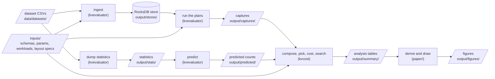

# python: the evaluator's Python side and the analysis

| package | what it holds |
|---|---|
| [`kvevaluator/`](kvevaluator/README.md) | what runs: the schemas, the datasets, the plans (each family's queries), the formats, the output tree, the measuring driver, and a small Python store that cross-checks the C++ counts |
| [`kvcost/`](kvcost/README.md) | the analysis on the counts: compose, cost, search for mixes, latency, predict accuracy, plots, and the `kvcost` command ([cli/](kvcost/cli/README.md)) |
| [`kvengines/`](kvengines/README.md) | optional: the real databases' clients and runners |

Dependencies go one way: `kvcost` and `kvengines` import `kvevaluator`, never the reverse (`tests/lint/check_layers.py`).

## Concepts

The words the commands and outputs use (one name per thing).

**KVformat.** How a graph is written into keys and values. Dgraph, NebulaGraph and ArangoDB each have one; this repo
runs all of them on one RocksDB store, so a difference in cost is the format's.

**Part.** What a layout sets on its own: the vertex properties, the adjacency (edge lists), and the index.

**Split, Condensed, Chunked.** The three settings of a part. Example, a person's properties:
- Split: one key per property: `(person 42, firstName) -> "Ada"`, `(person 42, lastName) -> "Lovelace"`.
- Condensed: one key per vertex: `(person 42) -> {firstName: "Ada", lastName: "Lovelace", ...}`.
- Chunked: one key per chunk of many vertices, packed to about a size: `(persons 40-57) -> [...]` at 4 KB.

**Layout.** A setting for each part. A uniform layout uses one setting per part for every type and is named
props-adjacency: `Sp-Co` is Split properties with Condensed adjacency (Dgraph's layout); `Ch4k-Ch4k` is Chunked at 4 KB
on both sides (Chunked with no size named is 64 KB: `Ch64k`). A **mix** gives each vertex type or edge type its own setting,
e.g. Condensed everywhere but Chunked `knows` lists. The configurable format, `meta`, builds any layout from a JSON spec
(`cpp/kvevaluator/src/formats/README.md`).

**Family and workload.** A family is a query set defined together: interactive, bi, microbench, writes, job,
linkbench. A workload is a file of queries with frequencies (i01, `ic7_ic2.json`, your `my.json`); its queries come
from one or more families of one dataset.

**What we count.** Each step of a plan counts its KV operations: S (SEEK, the start of a range read), G (GET, one
point lookup), N (NEXT, each further key of a range read), P (PUT) and D (DELETE), and the bytes in each lane (keys and
values, by GET and by scan). A **miss** is one of those operations that found nothing it asked for: a GET of a missing
key, or the NEXT that steps past a list's end. It is already in S, G or N; S_miss, G_miss and N_miss say how many of
them missed, they are not extra operations (`cpp/kvevaluator/src/store/counting.h`).

**Cost models.** One number from the counts, always named:
- `wops` = G + 1.1 S + 0.01 N (weighted operations; a write also adds P + D).
- `wops_bytes4k`, the op-byte cost = wops + bytes read / 4096: one 4 KB block read counts as one GET. It chooses plans.
- `ops_est_blocks` = wops + the estimated blocks read: a proxy for latency when the cache is bounded.
- `bill`: a pay-per-request store's price: per request, bytes rounded up to 4 KB for a read and 1 KB for a write.

For example, a step with S 1, G 0, N 13 and 1,040 bytes read has wops 1.23 and wops_bytes4k 1.48.
The formulas are in `python/kvcost/layout_cost/cost_models.py` and `python/kvevaluator/weights.py`.

**Plan, step, body.** A plan is the fixed list of steps that answers one query on one store; a step is one operation
(read a vertex's properties, read its neighbours, sort) run once. A query can have several **bodies**: plans that give
the same answer by different paths. LDBC IS2 has three: `index_walk`, `one_phase`, `two_phase`.

**Pick.** The body a store runs for a query: the cheapest by wops_bytes4k on the **held-out params** (rows 11-15 of the
query's parameter file), with a 10% margin. Results are **reported** on other params (rows 1-5), so a pick is never
judged on the rows that chose it (`python/kvevaluator/plan_choice/candidates.py`). The picks are recorded per store in
`inputs/picks/picks.csv`. The pick matters: IS2's `index_walk` walks the global message-date index (everyone's
messages, newest first) to find one person's 10 newest, and on NebulaGraph it costs about 97x the pick's wops_bytes4k,
on ArangoDB about 4,400x (SF3, rows 1-5); every layout runs its cheapest body, so no layout is charged for a plan it
would never choose.

**Measured, composed, predicted.** Three ways to get a layout's counts:
- measured: its store is built and every plan runs on it (`kvcost measure`, into `output/captures/`).
- composed: a layout or a mix priced from the parts of measured layouts, with no store, because a part's cost depends
  only on its own setting (`kvcost compose`, into `output/composed/`; `kvcost check-mix` builds one and checks
  measured = composed).
- predicted: estimated from graph statistics, with no store at all (`kvcost predict`, into `output/predicted/`).

## How the pieces connect

Each stage, with what it reads and writes:

1. **Ingest** reads the dataset's CSVs and the layout (a format's name, or a spec for the configurable format) and
   builds one RocksDB store per layout, under `output/stores/<dataset>/<scale>/`.
2. **Run the plans** runs each query's plans on a store, with the params in `inputs/params/`, and writes the counts per
   step and per plan: `output/captures/<dataset>/<scale>/<family>/<params>/{counts,parts,steps}/<layout>.csv`.
   `kvcost measure` does 1 and 2 for a set of layouts.
3. **Predict** is the other way to get counts, with no store: it reads the graph's statistics (`output/stats/`, dumped
   from the CSVs) and writes captures of the same shape under `output/predicted/`.
4. **Compose, pick, cost, search** (`kvcost`) read captures only: they compose the layouts not measured (under
   `output/composed/`), pick each query's plan, weigh the queries by a workload (`inputs/workloads/`) and write tables
   under `output/summary/<dataset>/<scale>/<analysis>/`.
5. **Derive and draw** (`paper/derive`, `paper/draw`) turn those tables, or the paper's, into a figure under
   `output/figures/<figure>/<run>/`.

`just results <figure>` runs 1-4 for one paper figure; `just figure <figure>` runs 5.

## The output tree

Every command writes into `output/` (`python/kvevaluator/output_tree.py` names every path;
`uv run --locked python -m kvevaluator.output_tree` prints one), by kind, then dataset, then scale:
`output/<kind>/<dataset>/<scale>/`, e.g. `captures/ldbc/sf0.1/`. The kinds:

| kind | holds |
|---|---|
| `stores/` | the built RocksDB stores, one per layout |
| `stats/` | the dataset's record stream, statistics and tallies (what predict reads), store sizes |
| `captures/` | measured counts per family and param set: `counts/`, `steps/`, `parts/`, `row-hashes/`, with each layout's run record |
| `composed/` | the same files for a layout composed from measured parts |
| `predicted/` | the same files predicted from statistics |
| `timings/` | timed runs: latency per layout and regime |
| `summary/` | the analyses' tables: layout costs, mix searches, predict accuracy, latency summaries |
| `figures/` | a drawn paper figure per run: `figures/<figure>/<run>/` |
| `engines/` | a real database's runs: answers, counters |
| `specs/` | the spec of a layout named on a command line that no spec set in `inputs/specs/` holds |
| `studies/` | a study that writes a whole tree of its own, in the same shape |
| `paper/` | the paper's tables and number keys made by `paper/derive/` |
| `checks/` | a check's own working files |
| `logs/` | run logs; `logs/journals/`: the cells in flight |

`paper-results/` is an output tree of the same shape: the paper's runs. A command that reads a tree reads it with
`--from paper-results`; nothing writes into it.

## Where files go

Each tool finds the repo root from its own location, so a clone works at any path. Four locations can move, through
the environment or a `.env` file at the root (see `.env.example`); a location inside another git checkout is refused:

| variable | default | holds |
|---|---|---|
| `KVEVAL_DATA_DIR` | `data/` | `datasets/` (LDBC SNB, IMDb, LinkBench: `just fetch-dataset`) |
| `KVEVAL_OUTPUT_DIR` | `output/` | the output tree |
| `KVEVAL_BUILD_DIR` | `build/` | the C++ build |
| `KVEVAL_CPP_BIN` | `build/cpp/kvevaluator` | the evaluator binary |

`uv run --locked python -m kvevaluator.paths` prints them.
