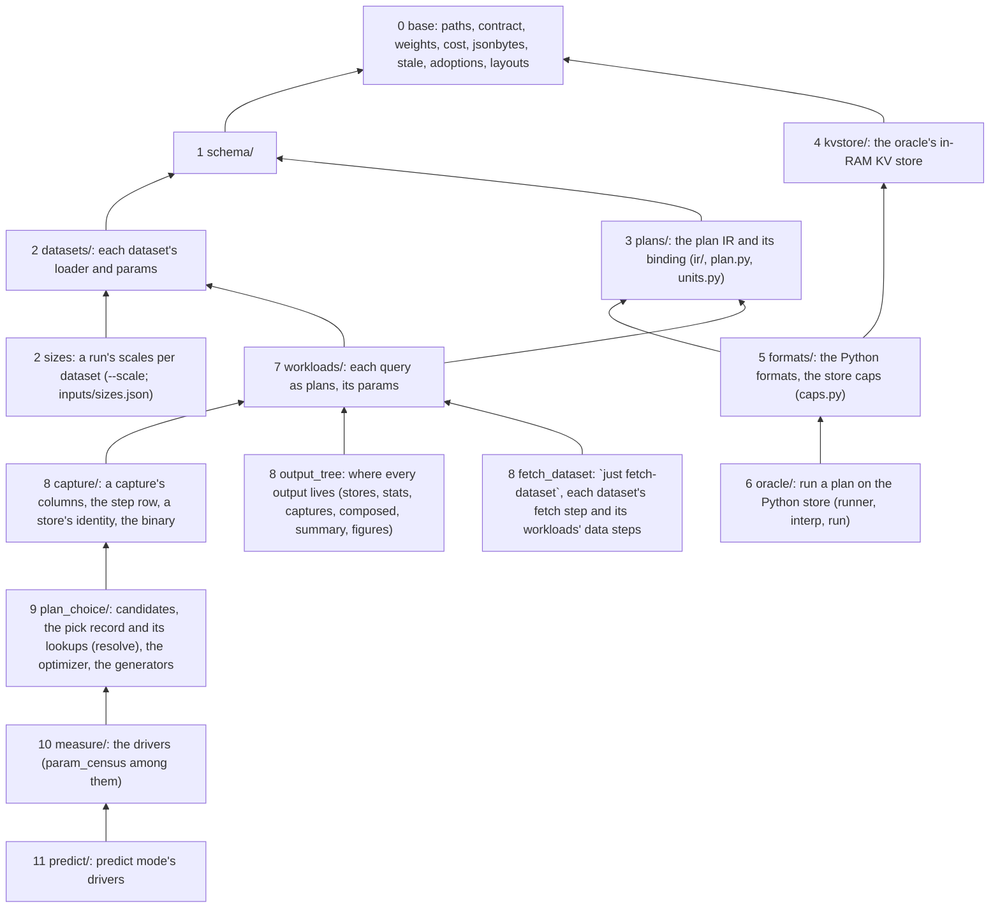

# kvevaluator: the evaluator in Python

It defines what runs (the schema, the datasets, the plan IR, the formats, the workloads), says what a capture and a
store are, chooses plans, and drives the C++ binary. It measures nothing itself: the Python store is an oracle for the
sf0.1 checks only.

## The layers

Each unit imports only its own layer and the layers below. `tests/lint/check_layers.py` holds the order (`LAYERS`) and
counts every import that goes up, also one inside a function (the `layer-up` ratchet, at 0: a new one fails `just lint`).

In words: a lower layer does not know a higher one. The plan IR (3) knows no format; a format (5) knows no workload;
`output_tree` (8) says where every output lives and `capture/` (8) what a capture's rows hold, for everyone above them;
`fetch_dataset` (8) gets a dataset's data and then what its workloads need beside it (JOB's reference answers), so a
dataset never imports a workload; plan choice (9) reads captures
to pick a body; the drivers (10, 11) run it all. A workload (7) binds the body it is handed (Interactive's
`bound_plan`, the microbench's `bound_body`); which body is plan choice's (`plan_choice/resolve.py`, from the pick
record).

Inside a layer the growth axes stay apart too: a dataset imports no workload, a workload no other workload, a format
only the shared format modules (`check_layers.UNITS`, `FORMAT_USES`).

## Where a new module goes

The lowest layer whose imports it needs. A helper that two layers both need goes to the lower one; never import up and
never re-export a name from a module it moved out of (move the callers).
